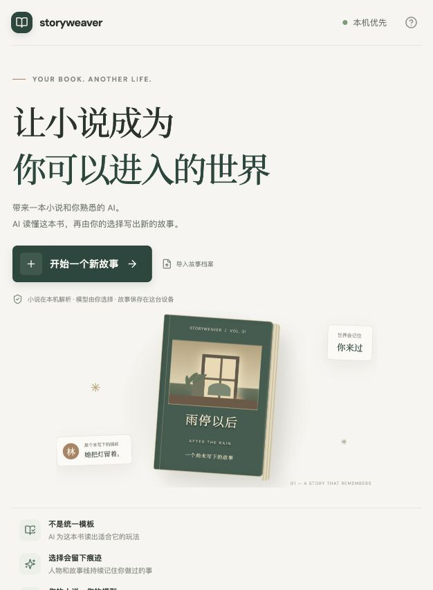
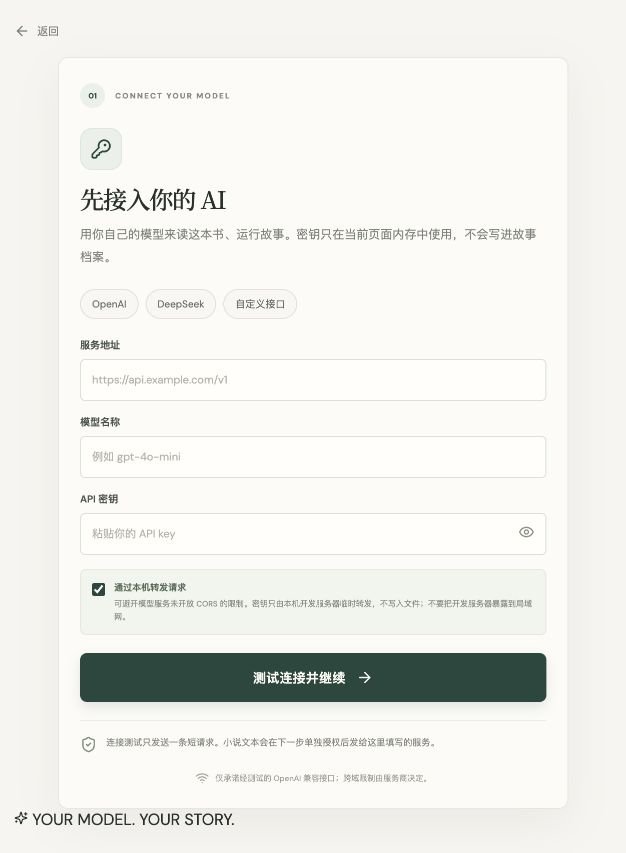

<div align="center">

# storyweaver

### 让小说成为你可以进入的世界

带来一本小说和你熟悉的 AI。让 AI 读懂原著，再从另一个角色、另一个时刻，写出一条属于你的故事线。

<p>
  
  
  
  
</p>

[产品方向](docs/superpowers/specs/2026-10-05-ai-novel-interactive-story-design.md) · [快速开始](#快速开始) · [隐私与数据](#隐私与数据) · [参与反馈](#参与反馈)

<br />



</div>

<br />

> 熟悉的世界，不必只有原著的一种走法。<br />
> Storyweaver 是一个仍在验证中的 AI 小说互动故事原型：它理解一本书，再为这本书寻找适合它的玩法。

## 故事从原著之外开始

通用聊天容易忘记前几回合发生了什么，固定 RPG 又会把不同小说压进同一套规则。Storyweaver 把原著当作有出处的世界资料，把玩家行动记录成另一条持续发展的故事线。

你可以成为原著角色，也可以带着原创角色走进故事。人物会依据原著中的性格与处境回应你；你的选择会改变关系、机会和后续走向。系统不要求每本小说都变成战斗、属性和任务。

## 一条新的故事线，如何长出来

| 01 · 带来小说 | 02 · 理解这本书 | 03 · 选择入口 | 04 · 写下行动 |
| --- | --- | --- | --- |
| 导入 TXT 或 Markdown，并连接你选择的模型 | AI 分批整理人物、关系、事件与叙事气质，并保留原文出处 | 扮演原著角色或原创角色，选择适合的故事起点 | 自由描述行动，让人物回应，让故事记住变化 |

<details>
<summary><strong>看看模型接入界面</strong></summary>
<br />

</details>

## 让小说的细节真正参与游戏

- **玩法随作品而变。** AI 从原文理解人物目标、关系、冲突和留白，再决定哪些状态值得追踪；不预设题材或通用属性表。
- **原著事实有出处。** 角色、事件与规则会保留来源章节和片段引用。原文明示内容与 AI 推断分开处理。
- **从你选的时刻进入。** 整本书用于建立世界资料；游玩时按当前故事进度取用原文，尽量避免把后续剧情提前交给玩家角色。
- **行动留下因果。** 玩家可以自由输入。人物关系、故事状态与近期变化会保存在同一条故事线里，读档后继续。
- **长篇生成按上下文合批。** 连接模型时选择其官方上下文窗口；系统最多使用约 75%，并限制单批输入预算为 256k token。章节可跨章合并，最多 4 批并行。
- **进度和检查点可追溯。** 批次、尝试次数、估算 token、等待上限、耗时、保存状态和诊断码会显示在生成页并写入浏览器本机存档；记录不包含密钥或原文内容，刷新后可恢复。
- **费用与重试透明。** 建世界前显示请求数和章节输入估算。超时、网络错误或限流时最多自动重试 2 次；超时后服务商是否已处理请求无法确认，重试可能产生重复费用。

## 当前原型支持什么

| 能力 | 当前状态 |
| --- | --- |
| 小说导入 | 单文件最大 25 MiB；支持 `.txt`、`.md` 与常见中文编码 |
| 模型接入 | 用户自带 API 访问信息；兼容 OpenAI Chat Completions 格式的服务 |
| 世界准备 | 按模型上下文动态合批、单批最多 256k 估算 token、最多 4 批并行、有限自动重试、本机检查点与续跑 |
| 故事体验 | 选择原著或原创角色、选择故事起点、自由输入行动、保存故事线 |
| 本机数据 | 小说索引、世界资料和故事档案存储在浏览器 IndexedDB |
| 故事档案 | 可导出、导入；档案不包含 API 密钥或小说正文 |

这仍是一个早期文字互动原型，不会生成独立的 2D/3D 游戏工程。PDF、EPUB、OCR、多人游玩、账号同步与云端存档目前不支持。模型生成的故事质量会因作品、模型和服务商而异，项目正在用真实长篇继续验证。

## 快速开始

需要 Node.js 18 或更新版本。

```bash
git clone https://github.com/zxycode7/storyweaver.git
cd storyweaver
npm install
npm run dev
```

打开终端显示的本机地址，填写模型服务地址、模型名称和 API 密钥，并按服务商公布的上下文窗口选择容量；测试连接后导入 `.txt` 或 `.md` 小说。密钥只在当前页面内存中使用，不会写入档案。

### 模型服务返回 CORS 错误？

在本机开发页面勾选“通过本机转发请求”。开发服务器会通过只绑定 `127.0.0.1` 的 Vite 代理转发模型请求，不写入密钥或小说内容。这是本机开发辅助功能；不要将开发服务器暴露到局域网或公网。生产页面需要模型服务开放对应来源的 CORS，或另行部署经过保护、明确说明数据流向的转发服务。

## 隐私与数据

- 小说先在浏览器本机解析。用户授权建世界后，小说片段会发送到用户选择的模型服务；Storyweaver 本身不接收小说正文或 API 密钥。
- 后续游玩请求也会把相关行动和当前故事进度内的原文片段发送给同一模型服务。费用由该服务商收取。
- 小说、世界资料、续跑检查点和故事档案保存在当前浏览器的 IndexedDB。清除浏览器站点数据会删除这些本机数据。
- API 密钥仅保存在页面会话内存中；刷新后需要重新连接模型。导出的故事档案不含 API 密钥和小说正文。
- 恢复档案时需要选择与原档案匹配的小说文件。不要上传你无权处理或分享的内容，并查看你所选模型服务商的数据政策。

## 本机开发与验证

```bash
npm install
npm run dev
npm test -- --run
npm run typecheck
npm run build
```

### 项目结构

```text
src/
  ai/           模型请求、世界构建、每回合故事推进
  components/   模型接入、小说导入、世界检查与游玩界面
  domain/       小说、世界模型、故事状态与校验
  storage/      IndexedDB 故事档案与续跑检查点
server/         仅供本机开发使用的模型转发中间件
tests/          AI、领域模型、存储与完整流程测试
docs/           产品设计与实现说明
```

## 参与反馈

Storyweaver 还在验证“AI 能否读懂不同类型的小说，并让玩家的选择产生持续后果”这个核心问题。欢迎提交 bug、模型兼容问题和真实使用反馈；分享问题时请不要附上 API 密钥、小说正文或私人对话。

[在 GitHub 查看 Storyweaver](https://github.com/zxycode7/storyweaver)
